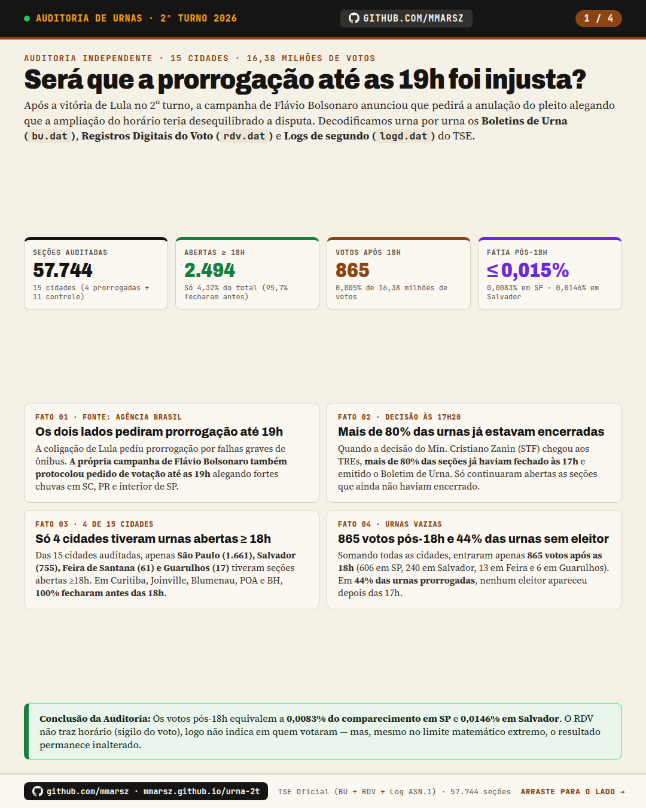
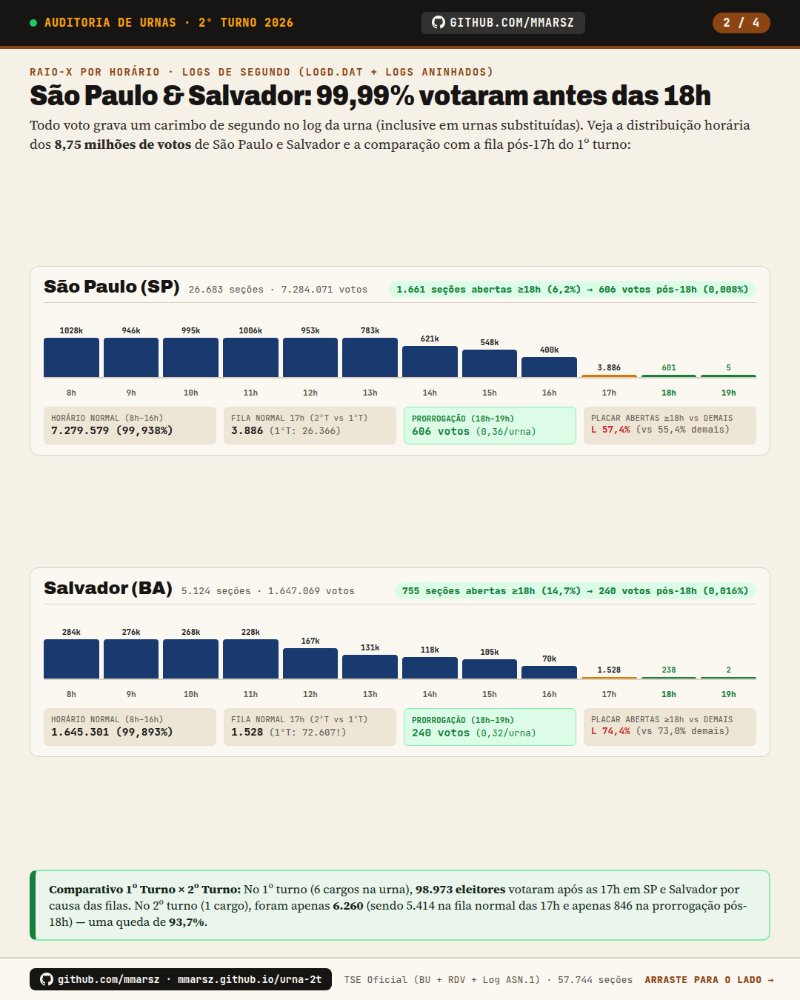
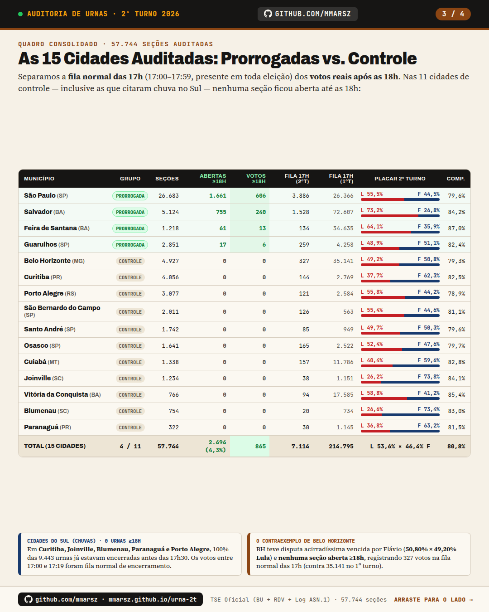
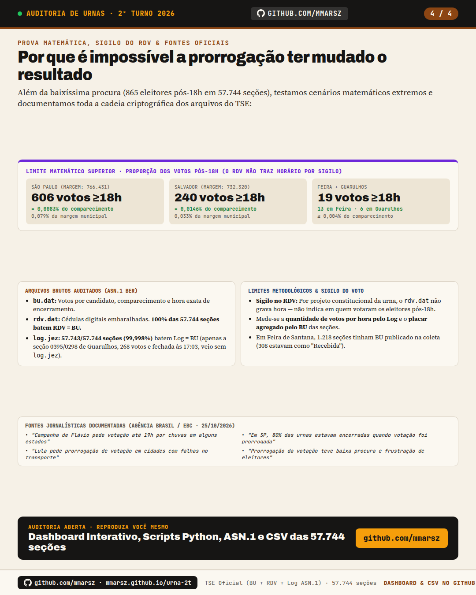

# Será que a prorrogação foi injusta? · Auditoria de Urnas (2º Turno 2026)

👉 **Dashboard Interativo ao Vivo:** **[https://mmarsz.github.io/urna-2t/](https://mmarsz.github.io/urna-2t/)**

Auditoria independente e 100% reprodutível dos **Boletins de Urna (`bu.dat`)**, **Registros Digitais do Voto (`rdv.dat`)** e **Logs operacionais com carimbo de segundo (`logd.dat`, incluindo logs aninhados de urnas de contingência)** de **57.744 seções eleitorais em 15 cidades brasileiras** (16.378.557 votos auditados) no 2º turno das Eleições Presidenciais de 2026 (25/10/2026).

---

## Resumo Visual (Série Instagram 1080p)

| Slide 1 — Os 4 Fatos Centrais | Slide 2 — Fluxo Horário (SP & Salvador) |
|---|---|
|  |  |

| Slide 3 — Quadro das 15 Cidades | Slide 4 — Impacto Matemático & Metodologia |
|---|---|
|  |  |

*(As imagens em resolução nativa **1080×1350 (4:5 Feed)** estão em [`instagram/`](instagram/) e em **1080×1920 (9:16 Stories/Reels)** em [`instagram/1080x1920/`](instagram/1080x1920/).)*

---

## Principais Conclusões

1. **Pedidos dos dois lados:** A coligação de Lula pediu prorrogação por falhas graves de transporte público; a própria campanha de Flávio Bolsonaro também protocolou pedido de votação até as 19h alegando fortes chuvas em SC, PR e interior de SP ([Agência Brasil](https://agenciabrasil.ebc.com.br/politica/noticia/2026-10/campanha-de-flavio-pede-votacao-ate-19h-por-chuvas-em-alguns-estados)).
2. **Mais de 80% das urnas já estavam encerradas:** Quando a decisão judicial chegou às 17h20, mais de 80% das seções em SP e na Bahia já haviam encerrado a votação e emitido o BU ([Agência Brasil](https://agenciabrasil.ebc.com.br/justica/noticia/2026-10/em-sp-80-das-urnas-estavam-encerradas-quando-votação-foi-prorrogada)).
3. **Apenas 4 de 15 cidades tiveram seções abertas ≥ 18h:** Das 57.744 seções auditadas, somente **2.494 (4,32%)** encerraram às 18h ou depois — concentradas em São Paulo (1.661), Salvador (755), Feira de Santana (61) e Guarulhos (17). Nas outras 11 cidades (incluindo Curitiba, Joinville, Blumenau, Paranaguá, Porto Alegre e Belo Horizonte), **100% das urnas fecharam antes das 18h**.
4. **Procura quase nula e impacto matemático irrisório:** Somando todas as 15 cidades, entraram apenas **865 votos após as 18h** (**0,0053%** dos 16,38 milhões de votos). Em São Paulo, os 606 votos pós-18h equivalem a **0,0083%** do comparecimento; em Salvador, os 240 votos pós-18h equivalem a **0,0146%** do comparecimento. Em **44% das urnas prorrogadas**, nenhum eleitor votou após as 17h. O RDV não traz horário (para preservar o sigilo constitucional do voto), logo não indica em quem votaram — mas, mesmo no limite matemático hipotético de 100% para um só lado, o resultado não se altera.
5. **Conferência de integridade:** `RDV == Comparecimento BU` em **100% das 57.744 seções**. Nos logs (`log.jez`), a contagem de votos bate 100% com o BU em **57.743 de 57.744 seções (99,998%)**; a única exceção é a seção `0395/0298` de Guarulhos (268 votos no BU e no RDV, encerrada às `17:03:06`), cujo pacote no TSE não incluiu o arquivo `log.jez` (como fechou às 17:03, não afeta as contagens pós-17h/18h).

---

## Quadro Consolidado das 15 Cidades Auditadas

| Município | Grupo | Seções Auditadas | Abertas ≥18h | Votos após 18h | Fila Normal 17h (2ºT) | Fila Pós-17h (1ºT) | Placar 2ºT (Lula × Flávio) |
|---|---|---:|---:|---:|---:|---:|---|
| **São Paulo (SP)** | Prorrogada | 26.683 | 1.661 | **606** | 3.886 | 26.366 | L 55,50% × 44,50% F |
| **Salvador (BA)** | Prorrogada | 5.124 | 755 | **240** | 1.528 | 72.607 | L 73,24% × 26,76% F |
| **Feira de Santana (BA)** | Prorrogada | 1.218 | 61 | **13** | 134 | 34.635 | L 64,15% × 35,85% F |
| **Guarulhos (SP)** | Prorrogada | 2.851 | 17 | **6** | 259 | 4.258 | L 48,91% × 51,09% F |
| **Belo Horizonte (MG)** | Controle | 4.927 | 0 | **0** | 327 | 35.141 | L 49,20% × 50,80% F |
| **Curitiba (PR)** | Controle | 4.056 | 0 | **0** | 144 | 2.769 | L 37,71% × 62,29% F |
| **Porto Alegre (RS)** | Controle | 3.077 | 0 | **0** | 121 | 2.584 | L 55,84% × 44,16% F |
| **São Bernardo do Campo (SP)** | Controle | 2.011 | 0 | **0** | 126 | 563 | L 55,37% × 44,63% F |
| **Santo André (SP)** | Controle | 1.742 | 0 | **0** | 85 | 949 | L 49,71% × 50,29% F |
| **Osasco (SP)** | Controle | 1.641 | 0 | **0** | 165 | 2.522 | L 52,36% × 47,64% F |
| **Cuiabá (MT)** | Controle | 1.338 | 0 | **0** | 157 | 11.786 | L 40,42% × 59,58% F |
| **Joinville (SC)** | Controle | 1.234 | 0 | **0** | 38 | 1.151 | L 26,18% × 73,82% F |
| **Vitória da Conquista (BA)** | Controle | 766 | 0 | **0** | 94 | 17.585 | L 58,78% × 41,22% F |
| **Blumenau (SC)** | Controle | 754 | 0 | **0** | 20 | 734 | L 26,58% × 73,42% F |
| **Paranaguá (PR)** | Controle | 322 | 0 | **0** | 30 | 1.145 | L 36,80% × 63,20% F |
| **TOTAL (15 CIDADES)** | **4 / 11** | **57.744** | **2.494 (4,3%)** | **865** | **7.114** | **214.795** | **L 53,57% × 46,43% F** |

---

## Estrutura do Repositório

- [`index.html`](index.html): Aplicação web interativa do dashboard (visão geral, página por município, mapa de zonas eleitorais, explorador de seções e página de seção individual).
- [`dados_dashboard.js`](dados_dashboard.js): Sumários agregados e curvas horárias das 15 cidades.
- [`dados/cidades/`](dados/cidades/): Microdados compactados por seção eleitoral carregados sob demanda pelo dashboard.
- [`dados/secoes_resumo.csv`](dados/secoes_resumo.csv): Planilha consolidada com todas as **57.744 seções auditadas**.
- [`baixar_secoes.py`](baixar_secoes.py): Downloader concorrente dos arquivos brutos de seção na CDN oficial do TSE (`resultados.tse.jus.br`).
- [`extrair_secoes.py`](extrair_secoes.py): Decodificador paralelo de `bu.dat` / `rdv.dat` (via especificações ASN.1 em [`spec/`](spec/)) e extrator recursivo de logs `.jez`.
- [`gerar_dados_dashboard.py`](gerar_dados_dashboard.py): Pipeline que consolida os `secoes.json` e `oficial_1t.json`/`oficial_2t.json` nos pacotes JS e CSV do dashboard.
- [`PROCEDIMENTO.md`](PROCEDIMENTO.md): Documentação técnica completa da coleta, endpoints do TSE e validação dos dados.

---

## Autoria

Desenvolvido e auditado por **[@mmarsz](https://github.com/mmarsz)**.
